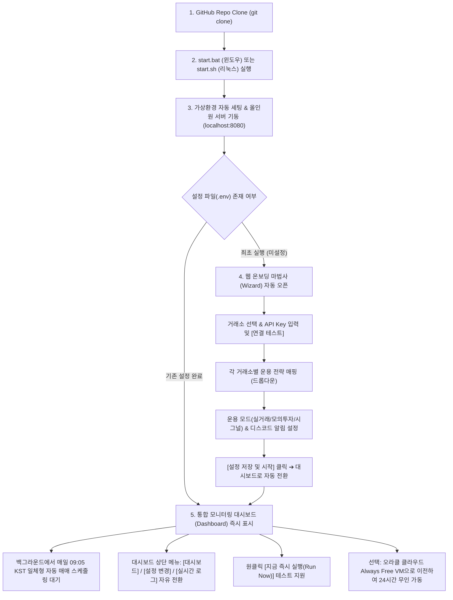

# 🧙 Crypto Quant Wizard - 상품 요구사항 정의서 (PRD)

---

## 1. 프로젝트 개요 (Overview)

### 1.1 프로젝트 정의
`crypto-quant-wizard`는 검증된 3대 거래소(업비트, 빗썸, 바이낸스) 암호화폐 퀀트 전략 엔진을 기반으로, **코딩이나 복잡한 서버 설정 지식이 없는 오픈소스 사용자도 GitHub에서 클론(Clone)하여 `start.bat` 또는 `start.sh` 한 번만 실행하면 웹 마법사를 통해 설정을 마치고, 자동 매매와 대시보드를 즉시 운용할 수 있도록 돕는 올인원 오픈소스 퀀트 트레이딩 플랫폼**입니다.

### 1.2 핵심 해결 과제 및 지향점
1. **극도의 시작 용이성 (Zero Build Friction)**:
   - Node.js/npm 등 별도 빌드 도구 불필요. Python 3.10+ 환경에서 `start.bat` (Windows) 또는 `start.sh` (Linux/Mac) 실행만으로 가상환경 구축, 의존성 설치, 웹 서버 및 스케줄러 자동 기동.
2. **거래소와 전략의 완전한 분리 (Decoupled Exchange & Strategy)**:
   - 거래소(업비트, 빗썸, 바이낸스)를 선택하고, 각 거래소별로 적용할 퀀트 전략(BTC/ETH 50:50 동적 리밸런싱, ETH SuperTrend 추세추종 등)을 드롭다운으로 매핑.
3. **완전 범용화된 웹 인터페이스 (Generalized Web Dashboard & Wizard)**:
   - PWA(서비스 워커, 매니페스트) 불필요 요소 제거.
   - 개인화된 하드코딩(특정 개인 PIN, 특정 깃허브 계정 링크 등)을 전면 제거하고 누구나 자신의 환경에 맞게 동적으로 로드되는 모던 웹 SPA(단일 웹앱) 제공.
4. **일체형 스케줄러 (All-in-One Daemon)**:
   - 로컬이든 오라클 클라우드(OCI)든 구동 방식 일원화. `start.bat` 또는 `start.sh`를 실행해두면 웹 서버 프로세스 내에서 매일 09:05 KST 자동 매매가 백그라운드로 함께 동작.
   - 로컬에서 테스트 후 오라클 클라우드 VM에 올려서 구동하면 로컬 PC를 24시간 켜둘 필요 없이 클라우드에서 단독 무인 운용 가능.
5. **예쁘고 친절한 오픈소스 README.md**:
   - 깃허브 방문자가 한눈에 이해할 수 있는 배지, 아키텍처 다이어그램, 3분 퀵스타트 가이드, 오라클 클라우드 이전 가이드 수록.
6. **Git 워크플로우**:
   - `dev` 브랜치에서 기능 개발 및 검증 수행 후, `main` 브랜치로 병합하여 깃허브에 배포.

---

## 2. 사용자 여정 (User Journey)

---

## 3. 세부 기능 요구사항 (Functional Requirements)

### 3.1 원클릭 런처 (`start.bat`, `start.sh`)
- **실행 환경**:
  - Windows: `start.bat` 더블 클릭.
  - Linux / Mac / Oracle Cloud: `bash start.sh` (또는 백그라운드 실행 `nohup bash start.sh > server.log 2>&1 &`).
- **부트스트랩 프로세스**:
  - Python 3.10+ 설치 유무 점검.
  - `.venv` 가상환경 확인 및 미존재 시 자동 생성.
  - `requirements.txt` 패키지 자동 설치 (`fastapi`, `uvicorn`, `pyupbit`, `requests`, `pandas` 등).
  - 웹 서버 + 스케줄러 백그라운드 구동 (`http://localhost:8080`).
  - 브라우저 자동 오픈(GUI 환경 시).

### 3.2 웹 온보딩 마법사 (Setup Wizard)
브라우저 접속 시 최초 1회(또는 상단 '설정 변경' 메뉴 클릭 시) 직관적인 다단계 폼 제공:

1. **거래소 선택 & API Key 입력**:
   - 지원 거래소 체크박스: [ ] 업비트(Upbit), [ ] 빗썸(Bithumb), [ ] 바이낸스(Binance).
   - 선택한 거래소별 Access Key / Secret Key 입력 폼 동적 렌더링.
   - **`[연결 테스트]` 버튼**: 입력된 키로 거래소 잔고 조회 API를 호출하여 유효성 및 IP 화이트리스트 통과 여부를 즉시 녹색/적색 뱃지로 표시.
2. **거래소별 전략 매핑 (Decoupled Strategy Mapping)**:
   - 사용자가 선택한 각 거래소에 적용할 전략을 드롭다운으로 선택:
     - **업비트**:
       - `전략 1 (기본 권장)`: BTC/ETH 50:50 동적 리밸런싱 (220일 SMA & ATR 채널)
       - `전략 2`: ETH 단독 추세 추종
       - `사용 안 함`
     - **빗썸**:
       - `전략 1 (기본 권장)`: ETH SuperTrend(7, 3.5) + 50일 SMA 100% 추세 추종
       - `전략 2`: BTC/ETH 50:50 리밸런싱
       - `사용 안 함`
     - **바이낸스**:
       - `전략 1 (기본 권장)`: BTCUSDT/ETHUSDT 50:50 테더 동적 리밸런싱
       - `사용 안 함`
3. **운용 모드 및 알림 설정**:
   - 운용 모드 라디오 버튼:
     - `모의매매(Dry-Run)` (기본 추천: 안전하게 가상 매매로 동작 검증)
     - `실거래(Live Trading)` (경고 팝업 확인 후 실제 주문 집행)
     - `시그널 브리핑(Signal Only)` (주문 없이 방향성 지표만 계산)
   - 디스코드 웹훅 URL 입력 및 `[테스트 발송]` 버튼.
4. **설정 영구 저장**:
   - `[설정 저장 및 가동]` 클릭 시 백엔드에서 `.env` 및 `config.json` 자동 갱신.
   - 완료 즉시 대시보드 화면으로 매끄럽게 전환.

### 3.3 범용화된 통합 대시보드 (Generalized Web Dashboard)
- **개인화 요소 전면 제거**:
  - 하드코딩된 개인 특정 정보, 개인 블로그/리포지토리 링크, 개인 고정 PIN 해시 제거.
  - 범용적인 모던 핀테크 UI (다크/라이트 모드 지원, Pretendard 웹폰트).
  - 필요 시 사용자가 브라우저에서 화면 잠금용 임시 PIN을 설정할 수 있는 클라이언트 옵션 제공(선택 사항).
- **실시간 종합 현황 카드**:
  - 사용자가 활성화한 거래소들의 통합 총 자산(실시간 USD/KRW 환율 적용 원화 환산).
  - 거래소별 코인 보유량(BTC, ETH) 및 평가금액, 현금 잔고(KRW, USDT).
- **당일 매매 행동 지침 배너**:
  - 오늘 아침 9시 확정 지표 기준 각 거래소/코인별 신호등 상태 (🟢 매수/보유, 🔴 현금화 관망, 🟡 버퍼 대기).
- **인터랙티브 60일 지표 차트 (Chart.js)**:
  - 활성화된 거래소/코인별 이동평균선(SMA), ATR 채널, SuperTrend 밴드 시계열 인터랙티브 차트.
- **자산 추이 그래프 & 체결 장부 테이블**:
  - 일자별 총자산 성장 곡선 (`data/asset_history.csv` 연동).
  - 최근 실거래 체결 이력 테이블 (`data/trade_history.csv` 연동).
- **상단 메뉴 탭 네비게이션**:
  - `[대시보드]`: 종합 모니터링 뷰.
  - `[설정 변경]`: 언제든 API Key 및 전략 매핑을 수정할 수 있는 화면.
  - `[실행 로그]`: 봇의 최근 실행 로그 및 콘솔 출력을 확인할 수 있는 뷰어.
- **컨트롤 액션**:
  - `[지금 즉시 실행 (Run Now)]`: 스케줄 시각을 기다리지 않고 지금 즉시 1회 분석/매매를 실행하고 결과를 화면에 갱신.

### 3.4 일체형 스케줄러 (Built-in Automation Engine)
- **동작 원리**:
  - FastAPI 서버 시작 시 백그라운드 APScheduler가 함께 기동.
  - 매일 09:05 KST(일봉 확정 직후) 정해진 시각에 활성화된 거래소/전략 엔진을 순차 실행.
  - 실행 결과는 자동으로 디스코드 알림 발송 + 체결 장부 갱신 + 대시보드 데이터 동기화.
- **로컬 vs 오라클 클라우드 환경 동일성**:
  - 로컬 PC: `start.bat`을 실행해두면 PC가 켜져 있는 동안 스케줄 수행.
  - 오라클 클라우드: VM에서 `bash start.sh` (또는 백그라운드 서비스)를 띄워두면 PC를 꺼도 클라우드에서 24시간 365일 무인 운용.

### 3.5 문서화 및 Git 워크플로우 (Docs & Repository)
- **`README.md` 고도화**:
  - 프로젝트 소개, 주요 기능, 스크린샷 뷰, 3분 로컬 퀵스타트(`start.bat`), 오라클 클라우드 Always Free 24시간 무인 배포 가이드.
- **Git 브랜치 체계**:
  - 개발 및 단위 테스트는 `dev` 브랜치에서 진행.
  - 완전 검증 완료 후 `main` 브랜치로 병합하여 깃허브 원격 저장소에 푸시.

---

## 4. 기술 스택 및 아키텍처

- **백엔드 & 서버**: Python 3.10+, FastAPI, Uvicorn, APScheduler.
- **프론트엔드**: 경량 단일 페이지(Vanilla HTML5, Modern CSS Variables, ES6 JavaScript, Chart.js CDN). (별도 Node.js 빌드 단계 없음)
- **트레이딩 엔진**: 기존 검증된 `indicators.py`, `pyupbit`, `bithumb_api.py`, `binance_api.py`, `discord_bot.py` 모듈 연계.
- **배포 지원**: Local Windows Batch (`start.bat`), Linux Shell (`start.sh`), Docker / Docker Compose.

---

## 5. 단계별 개발 계획

- **Step 1 (Git 준비)**: Git 초기화, `.gitignore` 점검, `dev` 브랜치 생성.
- **Step 2 (백엔드 API 및 설정 매니저)**:
  - 설정 파일 입출력 API (`/api/config`).
  - 거래소 API Key 연결 검증 API (`/api/test-exchange`).
  - 디스코드 웹훅 테스트 API (`/api/test-discord`).
  - 즉시 실행 트리거 API (`/api/run-bot`).
- **Step 3 (전략 엔진 모듈화 및 스케줄러)**:
  - 거래소-전략 드롭다운 매핑 구조 지원을 위한 설정 어댑터.
  - FastAPI 앱 내장 APScheduler 연동 (매일 09:05 KST).
- **Step 4 (범용 웹 UI 구축)**:
  - PWA 요소 제거 및 범용화.
  - 온보딩 마법사(Wizard) 폼 + 상단 탭(대시보드 / 설정 / 로그).
  - Chart.js 지표 시계열 및 자산 추이, 장부 테이블 연동.
- **Step 5 (원클릭 런처 및 문서화)**:
  - `start.bat`, `start.sh` 제작.
  - 친절하고 직관적인 `README.md` 및 `docs/ORACLE_CLOUD_GUIDE.md` 업데이트.
